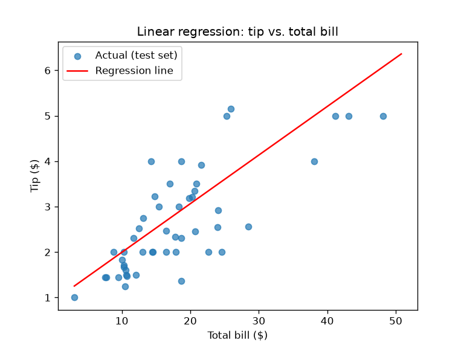

# Tip Predictor: Linear Regression

Does a bigger restaurant bill mean a bigger tip? A first data science project from the Codédex Machine Learning course.

**Stack:** Python, pandas, NumPy, scikit-learn, Matplotlib
**Data:** `tips.csv` (244 restaurant bills, from the seaborn-data repository)

## Result

- Model: `tip = 0.107 x bill + 0.925` (about 10 cents of tip per extra dollar)
- Test set: RMSE 0.754, R² 0.545, so the bill explains about half of the variation in tips
- Next step: multiple regression with party size as a second feature



## Run

```bash
pip install pandas numpy scikit-learn matplotlib
python3 linear_regression_project.py
```

It prints the metrics and saves `scatter.png` and `regression_line.png`.
