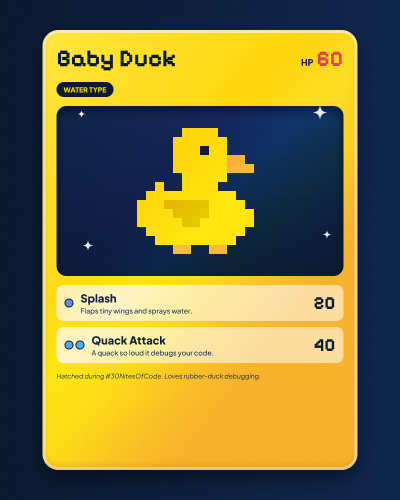
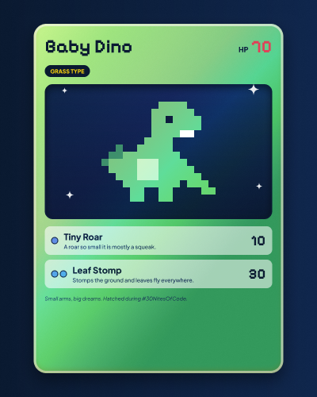
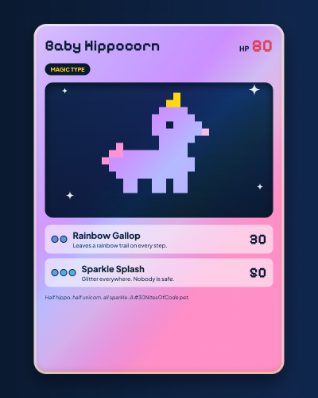
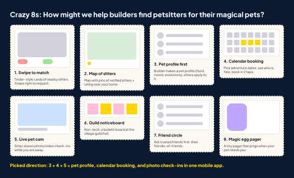
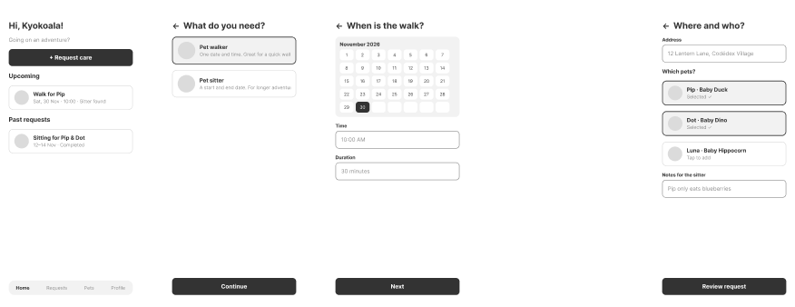
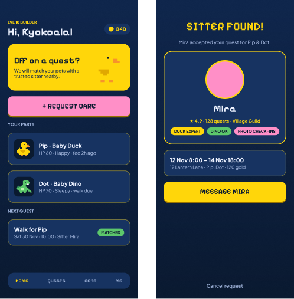

# UI/UX Design

Figma work from the Codédex UI/UX Design course (chapters 1 and 2). Pixel pets are my own 16x16 drawings.

## Trading cards

A holographic trading card built in Figma with auto layout, gradients, drop and inner shadows, and an overlay shimmer, then duplicated into a small deck.

| Baby Duck | Baby Dino | Baby Hippocorn |
| --- | --- | --- |
|  |  |  |

## PetPal: a petsitter app for magical pets

The design thinking process from start to finish:

1. **Ideate**: Crazy 8s, eight rough ideas in eight minutes. The chosen direction combines a pet profile, calendar booking and photo check-ins.
   
2. **Wireframe and user flow**: lo-fi mobile screens built from reusable Button and Input components, covering walker vs sitter, a single date vs a date range, address and pet selection, review, confirmation and managing past requests. Wired into a clickable prototype with 20 interactions.
   
3. **Test and iterate**: a self-run usability pass found that users want to know who their sitter is, which led to a new "Sitter Matched" screen.
4. **Hi-fi**: a game-style visual pass in navy and yellow with pixel pets.
   
